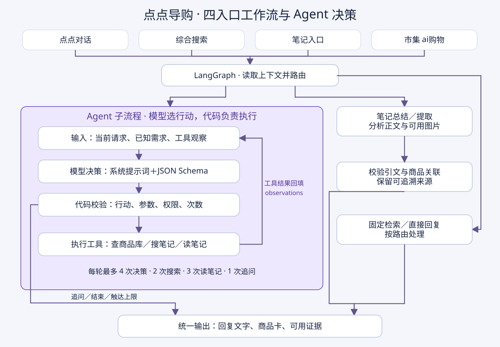

# 点点 · 有边界的 AI 导购原型

这是我结束小红书实习后，基于实习经历独立完成的个人复盘项目。我通过 AI 辅助开发，高仿真复刻了部分小红书界面，并实现了一个可本地运行的四入口导购原型。项目与小红书无官方合作关系。

## 在线交互小样

静态小样位于 [demo](demo/)，保留四个入口，仅收录 WH-CH720N，不调用模型、不需要密钥。公开仓库启用 GitHub Pages 后即可在线体验。它用于展示预置交互与单商品约束，不等于完整 Agent 的实时理解能力。

本地可运行 `python -m http.server 8000 --directory demo`，打开 `http://localhost:8000`。通过 `python scripts/build_demo.py` 重建小样。

## 四入口演示架构



综合搜索从搜索词和结果页触发；市集「ai购物」进入独立购物会话。两者入口和会话不同，可在后台复用 LangGraph 和导购 Agent。

[输入输出字段表](docs/点点导购全流程与字段.md) · [决策接口与提示词](docs/Agent决策接口与提示词.md)

## 能力与边界

- 香水与耳机共用目录接口、预算过滤、版本匹配、引用与选择记录。耳机按佩戴、连接、主动降噪、续航、重量、防护等级展示；不套用香水浓度/毫升字段。
- 对话和搜索使用有界Agent：模型选择追问、查询商品库、搜索笔记、读取笔记或结束，Python负责权限、条件校验与停止。上限4次决策、2次搜索、3篇读取，首次合并询问预算、场景与偏好；只回答预算即先推荐，再可选细化。明确预算尚未确定时展示未按预算过滤的参考候选，保留“预算待定”，不等同于不限；模型与图片请求各有超时。180秒是步骤间检查，不是强制中断整个请求的绝对时限。
- 模型将用户需求解析为结构化编辑；客观硬条件用类型、单位和测试模式校验。未知不算满足。续航是官方测试最长值，不能保证实际最低时长；单次与含盒总计分开，开/关降噪不互换。
- 主观偏好用带用户原文的约束和来源引用判断。代码验证格式、来源与归属，**无法保证模型对所有语言和体验描述的语义判断都正确**。推荐是当前小目录候选，不是全网最优。
- 首页来源笔记只展示缓存原帖的标题、作者与正文，不改写正文。未取得正文则留空，图片仍可独立分析；公开包不附带原帖全文或原图。
- 笔记弹层只保留“总结这篇”，有明确商品则自动提取。支持正文、图片文字和可见外观；无法确认型号时保留未知。逐图缓存、限制数量并发，复用已经成功的图片识别。
- 真实小红书读取是手机外侧的可选增强，需要另行安装兼容本地MCP服务并登录；当前候选包不包含该二进制、cookies或账号。没有MCP仍可演示本地笔记。视频、评论、实时商品价格和库存、订单支付均不支持。

## 真实资料范围

当前索引25个商品/版本：原17条身份索引及8个耳机版本。已核验可参与推荐的是4款香水与8款耳机，其中12条有中国官网标价（4款香水、8款耳机）。其余13条历史香水/蜡烛索引暂停推荐，不能使用原演示价；索引本身不等于参数已核验。预算明确时，未知价格商品不会入选；Sony价格按核验的具体颜色SKU记录，不推定其他颜色或结算实付价。

香水与Apple价格保留2026-10-15核验快照，4款Sony价格于2026-10-17补核，无实时库存接口。[耳机资料来源](docs/data/headphones-sources.md)、[原目录审核](docs/data/perfume-audit.md)。原英文资料卡仅作为内部图像测试样本，不进入正常笔记目录。公开包保留3篇笔记的来源元数据（正文空白）及代码绘制的示意封面；原帖图片仅在本地缓存中使用，不随公开包分发。

## 建议体验

商品库以香水和耳机为主：香水可按预算、香调与场景挑选；耳机可对照佩戴方式、降噪和续航。价格为已收录快照。

| 想看什么 | 从哪里开始 |
|---|---|
| 多轮保留需求 | 点点对话：「想买耳机」→「预算 1000 元」 |
| 指定品牌直出候选 | 综合搜索：「苹果耳机」 |
| 笔记原文与商品关联 | 打开含具体型号的笔记，点击「总结这篇」 |
| 理由、商品卡与快捷追问 | 市集 → ai购物：「预算1000元，想买通勤耳机」；真实模式可点「只看入耳式」继续筛选 |

可任选一个入口。mock 用于复现页面和会话流程，不验证自由表达的语义筛选。

## 技术结构

前端为原生JavaScript/HTML/CSS，后端为FastAPI，LangGraph连接流程节点，SQLite保存会话与任务；Pydantic校验模型JSON，OpenAI Python SDK调用百炼兼容端点。

```text
浏览器四入口（点点对话、综合搜索、笔记、市集 ai购物） → FastAPI请求/任务队列 → LangGraph
  对话/搜索：模型决策 → 受限工具 → 观察 → 再决策 → 事实卡片
  笔记：正文+逐图缓存识别 → 总结/商品提取 → 引用校验
                         ↓
        统一商品目录 / 官方来源 / 本地笔记 / 可选小红书MCP
```

主要代码：`catalog.py`加载目录；`product_facts.py`检查事实；`agent.py`执行循环；`model_client.py`调用模型；`workflow.py`连接节点；`shopping_logic.py`生成可追溯回答；`server.py`提供API；`web/xhs/`负责界面。知识库是小型JSON/CSV与笔记文件，当前没有向量检索或实时电商数据库。

## 快速运行

需要 Python 3.11+。安装依赖需要网络，mock运行不需要API Key或小红书MCP。

```sh
python3.12 -m venv .venv
source .venv/bin/activate
python -m pip install -r requirements.lock.txt
python -m pip install -e '.[test]'
python -m diandian --mode mock --port 4186
```

打开 [本地入口](http://127.0.0.1:4186/)。mock使用同一套检索、筛选和边界代码，但用规则模拟模型输出；它不代表真实语义理解或图片识别能力。

建议体验：

- 对话或搜索：`1000元耳机，用来通勤，必须主动降噪`。
- 对话：`1500元香水，通勤，喜欢清新`；继续问商品序号、价格或为什么没选某款。
- 首页打开运动耳机求助或CH720N体验整理，点击“问点点”→“总结这篇”。整理版注明原作者与原帖；有本地原图缓存时加载原图，没有缓存时使用示意封面。
- 先选香水，再说`不买香水了，改买耳机，预算1500元，通勤用`，检查条件切换。

## 使用真实模型

复制 `.env.example` 为 `.env`，填写自己的密钥、模型和控制台API Host：

```dotenv
MODEL_MODE=real
MODEL_NAME=qwen3.5-flash
MODEL_BASE_URL=https://dashscope.aliyuncs.com/compatible-mode/v1
DASHSCOPE_API_KEY=在本地填写，不要提交
```

```sh
python -m diandian --mode real --port 4186
```

默认采用阿里云百炼的 OpenAI 兼容协议。业务空间密钥如要求专属域名，必须使用对应控制台提供的 API Host，不能复制别人的地址。[官方接入域名说明](https://help.aliyun.com/zh/model-studio/base-url)。项目不提供免费额度或密钥，模型费用由自己的服务商账号收取。显式 `--mode mock` 可覆盖本地 `.env` 的真实模式，避免误调用。

Key只在后端使用；不发送到浏览器。会话、任务、图片缓存写入 `runtime/`，应保持本地。真实模型分析本地笔记时，会向配置的模型服务发送对应文字和图片。清理本地会话后，浏览器历史也可通过浏览器站点数据管理删除。

## 检查与复现

```sh
python -m pytest -q
node --test tests/*.test.mjs
```

Node建议20+，仅用于前端自动化检查。历史逻辑测试有明确标注的固定输入，保存在 `tests/fixtures/`，其中旧演示价格**不作为当前真实商品资料**；`test_multicategory.py`独立检查当前目录与新增路径。离线测试通过不等于真实大模型准确率通过。公开候选包仅包含新目录集成和前端测试；本地历史测试与原始整理笔记留在开发目录。

## 公开候选包

```sh
python scripts/package_release.py /tmp/diandian-public-candidate.zip
```

仅在本地生成，不上传。允许列表排除 `.env`、会话、缓存、真实笔记、个人业务空间、旧原型图片及历史工作文档；使用带来源的笔记整理独立展示。包内测试可独立运行。原创代码采用 [MIT 许可证](LICENSE)。第三方图片和品牌素材适用各自权利说明。[发布范围与下一步](docs/GitHub版本说明.md)、[第三方资料说明](docs/data/third-party-materials.md)。

