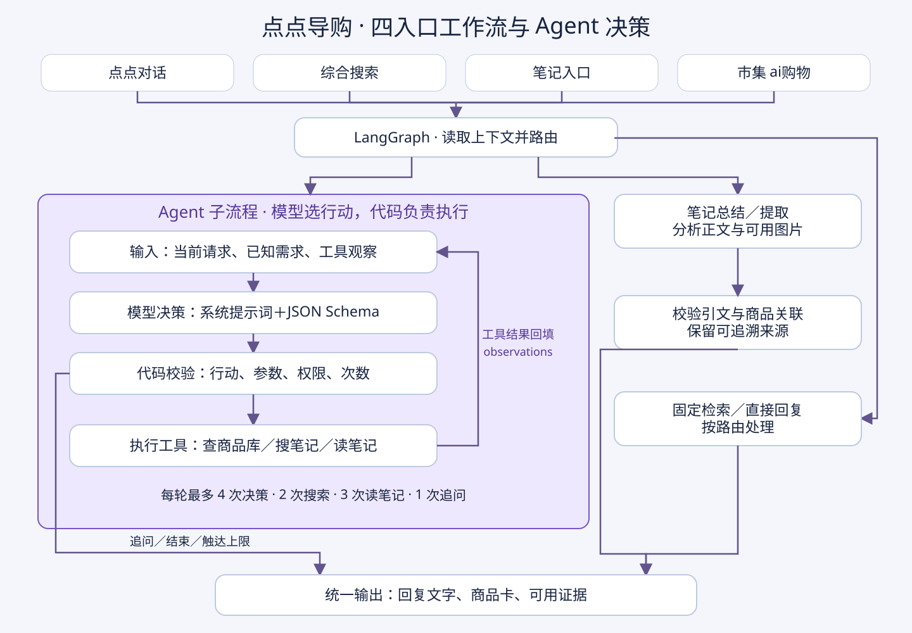

# 点点导购：全流程与字段对照

市集右上角「ai购物」使用独立会话，复用对话导购分支。紫色框表示导购 Agent 的循环。笔记总结、固定查询及直接回复按各自路径处理。

| Agent 输入 | 定义 |
|---|---|
| request.entry / request.message | 入口与本轮用户原话 |
| requirements | 已知条件：category、budget_min、budget_max、use_case、target、preference_constraints、attribute_filters 等 |
| conversation / previous_question | 近期对话与上次问题 |
| observations | 本轮工具观察，每项包含 action、ok、result |
| attribute_values / preference_assessments / preference_sources | 属性选项、匹配判断与来源 |
| limits / counts / clarifications_used | 行动上限、已用次数、追问计数 |
| available_sources / known_notes | 可用来源与笔记索引 |

| 模型输出 | 定义 |
|---|---|
| action | ask_user、query_catalog、search_notes、read_note 或 finish |
| requirements | 本轮明确的条件更新；代码负责合并历史状态 |
| ask_field / question | 待补字段与问题建议；代码确定是否追问 |
| query / search_scope | 笔记查询词与来源范围 |
| note_id | 要读取的笔记 ID |
| finish_route / product_ids | 结束时的结果类型和最多三个商品 ID |
| preference_evidence / reason | 偏好证据与简短行动目的 |

| 后端输出 | 定义 |
|---|---|
| status / answer | 结果状态与整理后的用户回复 |
| products / evidence | 校验后的商品与来源资料 |
| requirements / agent | 更新后的条件与 Agent 执行记录 |

示例：用户先说「想买耳机」，再回复「2000」。输入继承耳机品类和上次问题；模型可返回 query_catalog 与 budget_max=2000；代码筛选后把候选放回 observations，模型再选择 finish，后端输出商品卡。

源码与系统提示词：[Agent 决策接口与提示词](Agent决策接口与提示词.md)。
